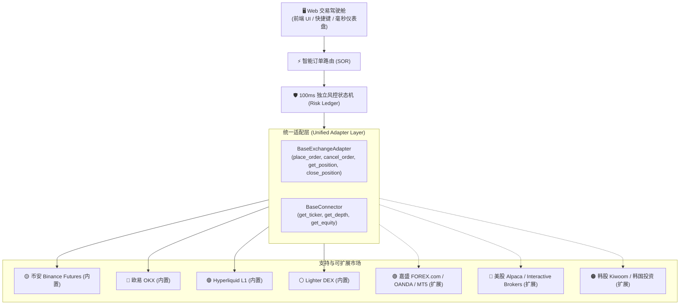

# 🌐 Titan HFT Cockpit 极速扩展指南 (Universal Extensibility Guide)

> **"一次编写，全球资产通吃。"**  
> Titan Cockpit 的核心设计理念是**资产无关性（Asset-Agnostic）**与**协议标准化**。无论是加密货币永续合约、外汇差价合约（CFD）、美股实时现货/期权，还是韩股高频打板，只需通过标准化接口接入，即可立即享用 Titan 控制台的所有顶级特性：
> - ⚡ 智能订单路由（SOR: Speed vs. Balanced Maker-Taker Fallback）
> - 🛡️ 100ms 物理级独立风控状态机（保本锁死、移动止盈、极速硬斩）
> - 🔒 底仓绝对物理隔离（只动本程序开仓，绝不误触长期手工仓）
> - ⌨️ Space 空格键秒平、H 键半仓锁定、盲打极速快捷键

---

## 📐 扩展架构全景图



---

## 🛠️ 三步接入任意新市场 / 交易所

接入一个全新的交易品种或券商，通常仅需 **100 ~ 150 行 Python 代码**，完成以下 3 步即可：

### 步骤 1：实现交易执行适配器 (`BaseExchangeAdapter`)

在 `core/exchange_adapter.py` 中继承或实现抽象基类：

```python
from core.exchange_adapter import BaseExchangeAdapter

class ForexComAdapter(BaseExchangeAdapter):
    """
    嘉盛 (FOREX.com) / MT5 / 外汇交易适配器示例
    """
    def __init__(self, api_key: str, secret_key: str, account_id: str):
        self.api_key = api_key
        self.secret_key = secret_key
        self.account_id = account_id
        # 初始化您的 REST / FIX / WebSocket 客户端

    def place_order(self, symbol: str, side: str, order_type: str, 
                    amount: float, price: float = None, post_only: bool = False) -> dict:
        """
        下单实现：
        - side: 'BUY' (买多) 或 'SELL' (卖空)
        - order_type: 'MARKET' (市价) 或 'LIMIT' (限价)
        - post_only: 是否只做 Maker (挂单被撮合，不吃单)
        返回包含 order_id, filled_qty, avg_price 的 dict
        """
        # 调用嘉盛 REST API 或 MT5 API
        # ...
        return {
            "order_id": "FX_12345678",
            "filled_qty": amount,
            "avg_price": price or 1.0850,
            "status": "FILLED"
        }

    def close_position(self, symbol: str, size: float = None, side: str = None) -> dict:
        """
        平仓实现 (必须是市价 Reduce-Only / 平仓动作)
        """
        # ...
        return {"status": "SUCCESS", "closed_qty": size}
```

---

### 步骤 2：实现行情与资产读取器 (`ReadConnector`)

在 `core/platform_connectors.py` 中实现对应的数据抓取：

```python
class AlpacaUSStockConnector:
    """
    美股 Alpaca / Interactive Brokers 行情与资产读取器
    """
    def __init__(self, api_key: str, secret_key: str):
        self.api_key = api_key
        self.secret_key = secret_key

    def get_equity(self) -> float:
        """获取账户当前可用 USDT / USD 净值"""
        # account = alpaca.get_account()
        # return float(account.equity)
        return 50000.0

    def get_ticker(self, symbol: str) -> dict:
        """返回标的实时最优买卖价 (BBO)"""
        # quote = alpaca.get_latest_quote(symbol)
        return {
            "bid": 182.45,
            "ask": 182.47,
            "last": 182.46,
            "timestamp": time.time()
        }
```

---

### 步骤 3：在标的清单与注册表登记 (`instruments_catalog.py`)

在 `config/instruments_catalog.py` 中添加标的规格：

```python
# 示例：添加嘉盛 欧元/美元 (EURUSD) 或 美股 特斯拉 (TSLA)
CORE_INSTRUMENTS["EURUSD"] = {
    "platform": "FOREX_COM",
    "symbol": "EURUSD",
    "displayName": "EUR/USD 嘉盛外汇",
    "contractType": "FOREX_SPOT_CFD",
    "tickSize": 0.00001,
    "lotSize": 1000,
    "minSize": 1000,
    "maxLeverage": 100
}

CORE_INSTRUMENTS["TSLA_US"] = {
    "platform": "ALPACA",
    "symbol": "TSLA",
    "displayName": "Tesla Inc (美股正股)",
    "contractType": "STOCK_EQUITY",
    "tickSize": 0.01,
    "lotSize": 1,
    "minSize": 1,
    "maxLeverage": 4
}
```

并在 `core/platform_registry.py` 中将该 Platform 标记为活跃。

---

## 🚀 启动即享：无缝继承的所有平台功能

当新标的注册完毕后，无需编写任何一行前端代码或风控逻辑：
1. **浏览器界面自动渲染**：侧边栏自动出现该品种，支持即时搜索与置顶。
2. **快捷键完美生效**：`[B]` 极速开多，`[S]` 极速开空，`[Space]` 一键秒平，`[H]` 50% 半仓止盈。
3. **风控自动接管**：滑块设定的止损 ROE、移动止盈（Trailing TP）与保本硬盾立即自动毫秒级监控该标的！
4. **AI Agent 原生兼容**：您的量化策略 Agent 可直接通过统一的 WebSocket / REST 指令操控这一全新市场。

Titan Cockpit 是您征服全球高频交易与日内动量套利的通用战舰！
