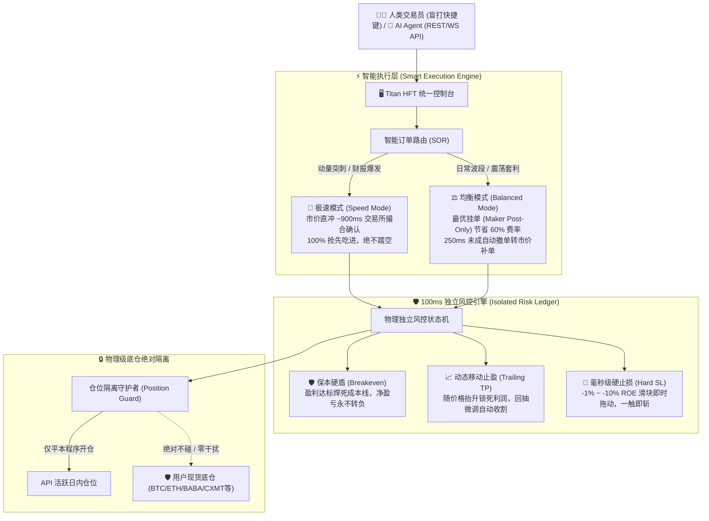

# ⚡ Titan HFT Cockpit (超光速量化高频交易控制台)

**Sub-Second Multi-Exchange Trading Terminal & Micro-Risk Engine for Humans and AI Agents**  
**面向个人交易员与自主量化智能体的「超低延迟多交易所高频交易控制台与微观风控执行系统」**

[](https://github.com/dll61/titan-hft-cockpit/actions)
[](https://opensource.org/licenses/MIT)
[](https://www.python.org/downloads/)
[](https://github.com/dll61/titan-hft-cockpit)
[](https://github.com/dll61/titan-hft-cockpit)

---

## 💡 为什么需要 Titan Cockpit？大白话告诉你散户是怎么亏光的

做过短线、打过插针、追过美股财报动量（比如 AMD、NVDA、SOXL 突刺）的朋友，一定经历过这四大绝望时刻：

1. **手续费磨损之痛**：一通操作猛如虎，一看收益负五百。市价吃单（Taker）费率高达 0.05%，一买一卖就吃掉 0.1% 的本金！频繁超短直接在给交易所“打黑工”，本金全被手续费磨光。
2. **手速与滑点之痛**：大单暴拉或财报公布的瞬间，行情 1 秒钟跳几个点。手工在交易所网页或手机 App 上点开仓、输数量、确认……等你点进去，行情已经见顶反抽了，直接站在高山顶上站岗！
3. **浮盈回吐与割肉犹豫**：赚钱的时候总觉得还能涨，结果一根大阴线直接反抽变成亏损；亏损的时候下不去手止损，抱侥幸心理抗单，最终小亏变成爆仓！
4. **一键全平误杀“长线底仓”**：很多交易软件的一键平仓粗暴无脑，直接把你账户里辛辛苦苦囤着的现货或长期手工底仓（比如阿里巴巴 BABA、长鑫 CXMT、比特币现货）一股脑全部以市价给卖了！

---

## 🚀 Titan Cockpit 的核心破局点：四大降维打击能力



---

### 1. ⚡ 智能订单路由 (Smart Order Routing, SOR)
兼顾**成交速度**与**手续费极致节省**的双模引擎：
- **极速模式 (Speed Mode)**：市价秒抢！专为暴拉、插针、重磅财报公布瞬间设计。毫秒级直接送达撮合引擎，确保在最黄金的动量起点切入，绝不踏空！
- **均衡模式 (Balanced Mode)**：**Maker 优先 + 250ms 自动 Fallback 补单**！
  - 第一步：先以最优买一/卖一发送 `Post-Only (GTX)` 挂单，享受 Maker 超低费率，直接节省 60% 手续费且零滑点！
  - 第二步：内置 250ms 超时监控，如果盘口瞬间跳走未成交，后台自动毫秒级撤单并无缝转市价吃单补足，**既省下了巨额手续费，又彻底杜绝了“挂单吃不到行情”的痛点！**

### 2. 🛡️ 100ms 纯独立物理级风控状态机 (Isolated Risk Ledger)
- **保本硬盾 (Breakeven)**：一旦浮盈触及设定的安全线，系统自动把止损线“焊死”在开仓成本价上方。只要浮盈过，这笔单子的净亏损概率在数学上就归零！
- **动态移动止盈 (Trailing TP)**：浮盈不断扩大时，止损线自动阶梯向上贴紧最高价；一旦顶部动量衰竭回抽，立即自动市价斩仓锁定利润，吃到鱼身最肥美的一段！
- **毫秒级硬止损 (Hard SL)**：界面提供 -1% 到 -10% ROE 无感滑块，键盘 `[F]` 键秒速对焦调节。后台独立线程 100ms 轮询检测，一旦击穿立即市价执行，绝不给行情深套你的机会！

### 3. 🔒 物理级底仓绝对隔离 (Physical Bag Isolation)
- 控制台只对由本程序开出的仓位建立独立追踪账本（`api_opened_positions`）。
- **当您点击一键平仓或触发止损时，系统只会平掉本程序开出的仓位**！
- 账户内的**现货储备、长线手工定投底仓（如 BTC、ETH、美股现货 BABA、CXMT 等）处于物理级保护状态，绝不触碰一分一毫**！

### 4. ⌨️ 极速盲打与一键保命快捷键 (Muscle Memory Hotkeys)
在波诡云谲的高频博弈中，动鼠标点确认就慢了半拍。Titan 控制台支持纯键盘盲打：
- `[Space]` **空格键**：🚨 **全网最快一键秒平**！当前标的瞬间 100% 市价全平逃生！
- `[H]` **键**：⚡ **一键平半仓 50%**！吃到动量先落袋为安一半利润，用利润当垫子放飞剩下的仓位！
- `[B]` 或 `[↑]` 方向键：**极速开多** (Buy / Long)
- `[S]` 或 `[↓]` 方向键：**极速开空** (Sell / Short)
- `[F]` **键**：快速对焦并调节止损滑块

---

## 🌐 极致的可扩展架构：全宇宙资产通吃

Titan Cockpit 不仅是加密货币控制台，而是一个**通用金融交易执行底座**！

| 交易市场 / 品种 | 支持状态 | 典型代表标的 | 接入说明 |
| :--- | :--- | :--- | :--- |
| **币安合约 (Binance Futures)** | ✅ **官方原生开箱即用** | BTC, ETH, SOL, 以及 **SOXL**, TSLA, NVDA 等代币化美股合约 | 内置高频适配器，深度优化网络 |
| **欧易 (OKX)** | ✅ **官方原生开箱即用** | BTC, ETH, OKB 永续与交割合约 | 支持 WebSocket 毫秒级盘口深度 |
| **去中心化 DEX (Hyperliquid)** | ✅ **官方原生开箱即用** | Hyperliquid L1 极速永续合约 | 原生无滑点高频 L1 引擎对接 |
| **外汇与差价合约 (Forex / CFD)** | 🔌 **插件化轻松扩展** | 嘉盛 (FOREX.com), OANDA, MT5, FIX Protocol | 仅需实现 `BaseExchangeAdapter`（见 [扩展指南](EXTENSION_GUIDE.md)） |
| **美股与期权 (US Stocks)** | 🔌 **插件化轻松扩展** | Alpaca, Interactive Brokers (盈透), TradeStation | 现货与美股期权超短日内高频 |
| **韩国股市 (KRX / Korean Stocks)** | 🔌 **插件化轻松扩展** | Kiwoom Open API, 韩国投资证券 (KIS Developers) | 专打早盘动量突刺与极速打板 |

> 📖 查看详细接入教程：[👉 极速扩展开发指南 (EXTENSION_GUIDE.md)](EXTENSION_GUIDE.md)  
> 仅需 100~150 行 Python 代码，就能把全世界任何交易所接入本控制台，零成本享用整套 UI、快捷键与 100ms 风控！

---

## 🤖 既是人类驾驶舱，又是 AI Agent 执行大脑

Titan Cockpit 提供双向赋能：
- **对人类交易员**：直观、酷炫的暗黑赛博终端 UI，零延迟仪表盘，全键盘极速盲打。
- **对 AI Agent / 自动化策略**：提供统一、纯粹的 RESTful API 和 WebSocket 实时行情与仓位流。大模型 Agent（如基于 Claude、GPT、DeepSeek 构建的自主交易智能体）可直接发出买卖指令，交由底层原子风控状态机安全保驾护航。

---

## ⚡ 1分钟极速上手指南

### 1. 克隆代码仓库

```bash
git clone https://github.com/dll61/titan-hft-cockpit.git
cd titan-hft-cockpit
```

### 2. 安装轻量依赖

控制台追求极致轻量与高响应，仅依赖 FastAPI、Uvicorn 等几个核心 Python 库：

```bash
pip install -r requirements.txt
```

### 3. 配置 API 凭证 (绝对安全，永不泄密)

复制配置模版：

```bash
cp .env.example .env
# 或者使用 JSON 配置文件
cp config/credentials.example.json config/credentials.json
```

在 `.env` 或 `credentials.json` 中填入您的交易所 API Key（仅需交易权限，绝不要开通提现权限！）。  
*（注：`.env` 和 `credentials.json` 已被 `.gitignore` 严密拦截，绝不会误提交至任何代码仓库）。*

### 4. 一键启动控制台

```bash
python run_console.py
```

终端启动后，系统会自动在默认浏览器打开控制台：
👉 **http://127.0.0.1:57890/**

- 默认以**安全只读/模拟模式**运行，您可以随意熟悉界面、调节滑块、测试快捷键。
- 若要解锁**真实账户实盘交易**，启动时加上 `--live` 参数即可：
  ```bash
  python run_console.py --live
  ```

---

## 🧪 单元测试与质量验证

本项目拥有完善的单元测试覆盖，涵盖智能路由、风控状态机、仓位计算与交易所抽象层：

```bash
pytest tests/ -v
```

测试结果：**67/67 tests passed (100% 绿色通过，耗时仅 ~3 秒)**。

---

## 🔒 隐私与安全声明 (Zero-Leakage Guarantee)

1. **零外部数据回传**：本控制台为 100% 本地开源软件，所有 API 通信均由本机直接向对应交易所官方节点发起，没有任何第三方中转服务器，没有任何遥测代码。
2. **严密的防泄露设计**：所有凭证对象在内存中均重写了 `__repr__`，打印日志时自动脱敏为 `<redacted>`，绝不会打印到日志或报错堆栈中。
3. **安全准则**：强烈建议仅赋予 API 密钥“读取与交易”权限，**严禁开启“提现”权限**！

---

## 📜 开源协议

本项目基于 [MIT License](LICENSE) 协议开源，欢迎自由使用、修改与商业集成。如果您觉得好用，请给项目点一个 ⭐️ **Star**！

---

## 💬 交流与贡献

欢迎提交 Issue 和 Pull Request，一起把 Titan Cockpit 打造成全球最快、最好用、最安全的多资产量化交易终端！
